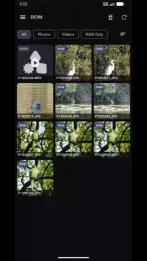
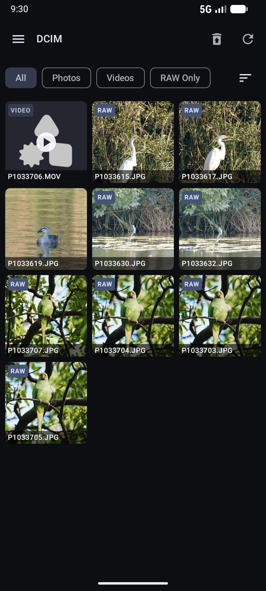
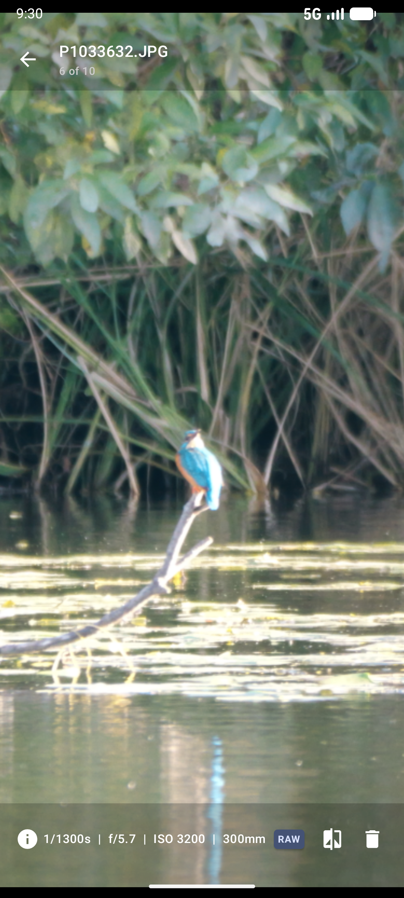
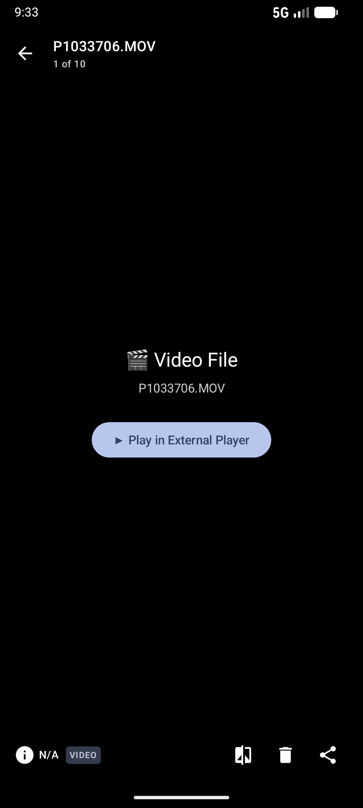
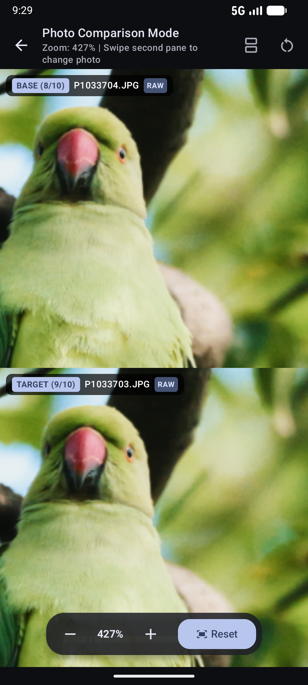
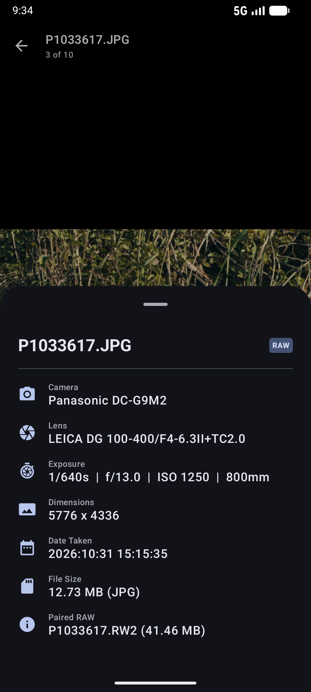

# Photo Select (日本語)

[English](README.md) | [開発者向けドキュメント](README-dev.md)

**Photo Select** は、SDカードや外部ストレージ内に保存された大量のカメラ撮影写真（JPEG/HEIF＋RAWペア）および動画を、高速に閲覧・選別（セレクト）・比較・共有・削除・管理するためのAndroid向け高機能写真選別アプリケーションです。

---

## 📸 デモ動画 & 画面イメージ (Demo & Screenshots)

  

  
  
  

  
  

---

## 🌟 主な機能 (Key Features)

### 1. SAF（Storage Access Framework）によるSDカード直接アクセス
- Androidの Storage Access Framework (SAF) を使用し、SDカードやカメラのルートフォルダ（`DCIM/100MSDCF` など）を直接選択可能。
- 永続的なアクセス権限（`takePersistableUriPermission`）により、サイドナビゲーションメニューから複数フォルダを瞬時に切り替え可能。
- フォルダ配下のサブディレクトリをプログレッシブにスキャンし、即座にグリッド表示を開始します。

### 2. メインJPEG/HEIFプレビューとRAWペア自動連動管理
- 同一ベースファイル名（例: `DSC0001.JPG` と `DSC0001.RW2`）を持つファイルを自動的に **`MediaGroup`** として1つのカードに結合。
- 重いRAWファイルを展開せず軽量なJPEG/HEIFをメイン表示するため、一覧表示やグリッドスクロールが極めて高速です。
- 不要な写真を削除または移動する際は、メインのJPEGだけでなく、ペアリングされたRAWファイルも自動的に連動処理されます。

### 3. 完全同期対応の2画面並列比較 (Side-by-Side Comparison)
- ピント確認や微小な表情差の選別のために、任意の2枚を選択して即座に並列比較（Side-by-Side）が可能。
- **同期パン＆ズーム**: 片方の画像を拡大・移動すると、もう片方の画像も同一倍率・同一座標へミリ秒単位で完全に同期追従。
- **ダブルタップ・ズームリセット**: ダブルタップで即座に拡大/等倍リセット。
- **フレキシブル分割レイアウト**: 端末の回転に応じた自動切り替えに加え、左右分割 (Horizontal) / 上下分割 (Vertical) を任意にトグル可能。

### 4. 安全なゴミ箱 (Trash) 機能 & 復元サポート
- ファイル削除時、ルートフォルダ配下の `Trash` ディレクトリへ一時退避。誤操作によるSDカードからの即時抹消を防ぎます。
- ゴミ箱画面から、削除した写真・動画の個別復元、永久削除、および「ゴミ箱を空にする」一括消去が可能です。

### 5. 詳細EXIFメタデータ解析とオーバーレイ表示
- `ExifInterface` を活用し、SAF Uriから直接写真の撮影情報を抽出。
- **表示項目**:
  - シャッタースピード、絞り値 (F値)、ISO感度、焦点距離
  - カメラメーカー・モデル名、レンズモデル名
  - 画像解像度 (幅 x 高さ)、ファイルサイズ & 撮影日時
- フルスクリーン表示画面からワンタップで美しくフォーマットされたオーバーレイシート（ExifBottomSheet）を表示。

### 6. FileProvider による外部編集アプリ連携 (External App Sharing)
- アプリで選別したメインJPEG/HEIFファイル、またはペアリングされたRAWファイル（.RW2, .ARW, .CR3, .NEF, .DNG など）を、Lightroom、Snapseed、Photoshopなどの外部現像・編集アプリへダイレクトに共有可能。
- `FileProvider` (`com.github.fujimotok.photoselect.fileprovider`) を使用し、安全かつ確実に `ACTION_SEND` インテントで外部共有を行います。

### 7. 多彩なフィルタリング & ソート
- **フィルタ**: すべて / 写真のみ / 動画のみ / RAWあり
- **ソート**: 撮影日時（新しい順/古い順）、ファイル名（昇順/降順）、ファイルサイズ（大きい順/小さい順）

### 8. DataStore による拡張子カスタマイズ
- メインプレビュー用拡張子（デフォルト: `JPG, JPEG, HIF, HEIC`）およびペアRAW用拡張子（デフォルト: `RW2, ARW, CR3, NEF, RAF, ORF, DNG`）を自在にカスタマイズ可能。
- 設定内容は Jetpack DataStore に保存され、リアルタイムに一覧へ反映されます。

---

## 📱 使い方 (How to Use)

1. **SDカードフォルダの選択**:
   - アプリ初回起動時、画面上の「Select SD Card Folder」ボタン（またはサイドメニュー）をタップします。
   - カメラのSDカードまたは写真が保存されているフォルダを選択し、アクセスを許可します。

2. **ギャラリー一覧の閲覧・フィルタリング**:
   - 選択したフォルダ内の写真・動画がグリッド表示されます。
   - RAWペアが存在する写真には **「RAW」** バッジ、動画には **「VIDEO」** バッジが表示されます。
   - 上部のチップから「Photos Only」「Videos Only」「RAW Available」などの絞り込みやソートが可能です。

3. **単一アイテムの詳細閲覧・動画再生**:
   - 写真をタップすると、高解像度プレビュー画面に遷移し、ピンチイン/ピンチアウトで自由拡大・パン移動できます。
   - 下部の「i」アイコンでEXIF情報を確認、共有アイコンからJPEGまたはRAWを外部アプリへ送信できます。
   - 動画ファイルは外部動画プレーヤーで高画質再生が可能です。

4. **2枚の写真の並列比較**:
   - グリッド上で項目を長押しまたはチェックマークタップで選択モードを開始します。
   - 2枚の画像を選択し、上部バーの「Compare」ボタンをタップすると、同期ズーム・パン比較モードに入ります。

5. **ゴミ箱移動・復元**:
   - 不要な画像を選択してゴミ箱アイコンをタップすると、RAWファイルも含めて安全にゴミ箱へ移動します。
   - サイドメニューの「Trash」からゴミ箱画面を開き、復元や完全消去が行えます。

---

## 🛠️ 動作環境 (Requirements)
- **OS**: Android 8.0 (API Level 26) 以上
- **推奨**: Android 12 以上 (Dynamic Colorテーマ対応)
