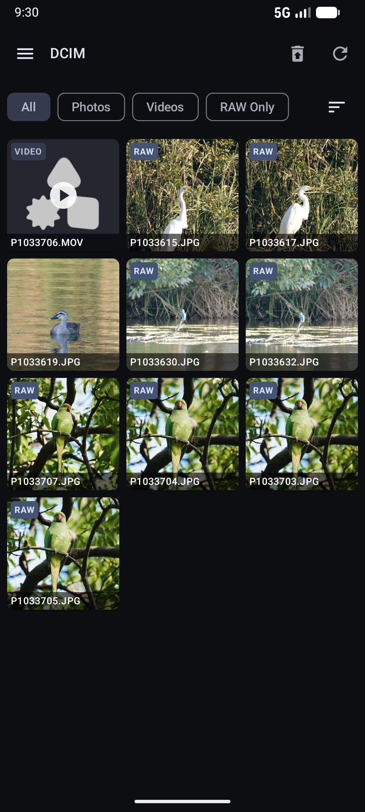
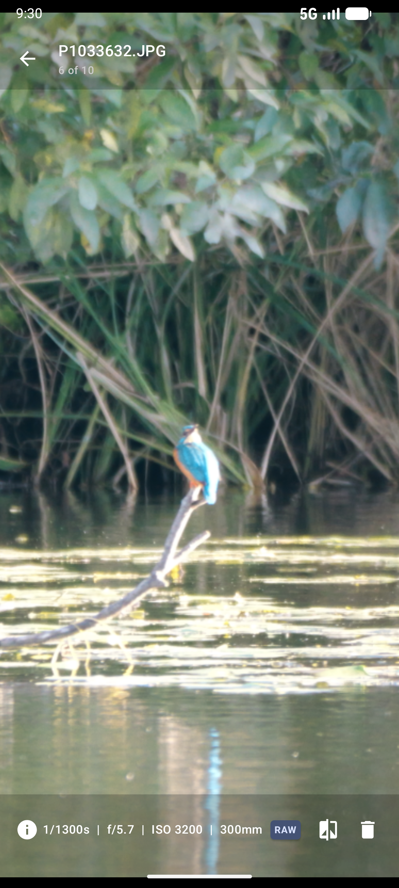
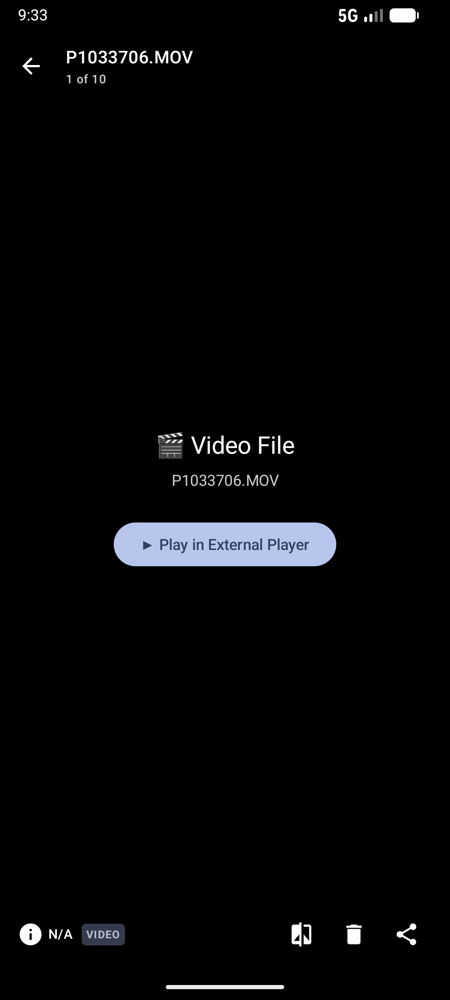
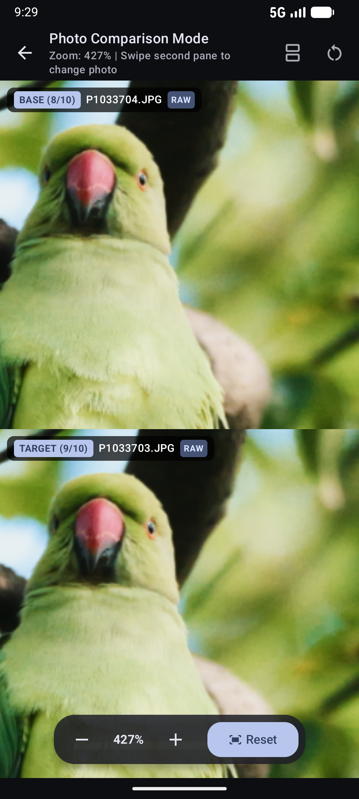
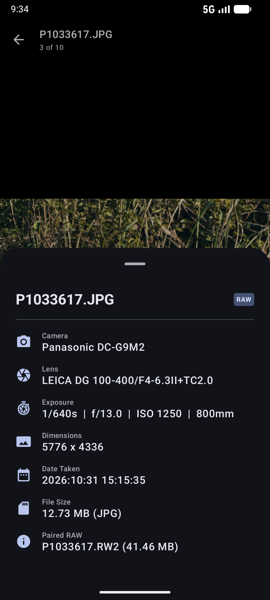

# Photo Select

[日本語 (Japanese)](README-ja.md) | [Developer Guide](README-dev.md)

**Photo Select** is a high-performance Android gallery and file management application built for photographers. It allows users to quickly review, select, compare, share, and manage large volumes of camera photos (JPEG/HEIF + RAW pairs) and videos directly from SD cards or local storage.

---

## 📸 Demo & Screenshots

  <video src="https://github.com/user-attachments/assets/659b6eda-c372-43cd-a24d-a1afdc6bd7a6" width="360" controls="controls" style="max-width: 100%;"></video>

  
  
  

  
  

---

## 🌟 Key Features

### 1. Direct SD Card Access via Storage Access Framework (SAF)
- Access root folders (e.g., `DCIM/100MSDCF`) directly on SD cards or external storage using Android's native Storage Access Framework (SAF).
- Persists permissions (`takePersistableUriPermission`) to quickly switch between multiple root directories via the side navigation drawer.
- Progressive file scanning renders thumbnails immediately without waiting for full directory indexation.

### 2. Automatic JPEG/HEIF + RAW Pairing & Linked File Management
- Automatically groups files with matching base names (e.g., `DSC0001.JPG` and `DSC0001.RW2`) into a unified **`MediaGroup`**.
- Renders lightweight JPEG/HEIF previews for ultra-fast grid scrolling while keeping heavy RAW files linked in the background.
- Operations like moving, copying, or deleting automatically handle both the primary preview file and its paired RAW file together.

### 3. Synchronized Side-by-Side Photo Comparison
- Compare any two photos side-by-side to inspect focus accuracy, sharpness, and subtle facial expressions.
- **Synchronized Panning & Zooming**: Zooming or panning one photo simultaneously mirrors the exact scale and offset coordinates onto the second photo in real-time.
- **Double-Tap Quick Zoom**: Double-tap to instantly toggle between 100% fit and 250% zoom.
- **Flexible Split Layout**: Supports automatic orientation switching as well as manual Horizontal (left/right) and Vertical (top/bottom) split views.

### 4. Built-in Trash & Recovery System
- Moving files to delete places them into a dedicated `Trash` directory within the root folder, preventing accidental permanent data loss from SD cards.
- View, restore, or permanently delete individual items from the Trash screen, or perform a full "Empty Trash" purge.

### 5. Comprehensive EXIF Metadata Inspection
- Extracts shooting parameters directly from image Uri streams using `ExifInterface`.
- **Displays Key Camera Metrics**:
  - Shutter Speed, Aperture (f-number), ISO sensitivity, Focal Length
  - Camera Make & Model, Lens Model
  - Resolution (Width x Height), File Size, and Capture Timestamp
- Beautiful bottom sheet overlay (`ExifBottomSheet`) accessible with a single tap in full-screen mode.

### 6. External App Integration (Lightroom / Snapseed Sharing)
- Share primary JPEG/HEIF images or raw camera files (`.RW2`, `.ARW`, `.CR3`, `.NEF`, `.DNG`, etc.) directly to professional editing tools like Adobe Lightroom, Snapseed, or Photoshop.
- Utilizes `FileProvider` (`com.github.fujimotok.photoselect.fileprovider`) for secure cross-app content sharing.

### 7. Advanced Filtering & Sorting
- **Filter**: All Items / Photos Only / Videos Only / RAW Available
- **Sort**: Date Taken (Newest/Oldest), Filename (A-Z / Z-A), File Size (Largest/Smallest)

### 8. Customizable Extension Settings
- Customize recognized primary preview extensions (Default: `JPG, JPEG, HIF, HEIC`) and paired RAW extensions (Default: `RW2, ARW, CR3, NEF, RAF, ORF, DNG`).
- Preference changes persist across app launches using Jetpack DataStore and update the gallery in real-time.

---

## 📱 How to Use

1. **Select SD Card Folder**:
   - Tap "Select SD Card Folder" or open the side drawer on first launch.
   - Choose your camera's SD card directory in the system picker and grant access.

2. **Browse Gallery**:
   - View photos and videos in a clean responsive grid.
   - Items with paired RAW files display a **"RAW"** badge; videos show a **"VIDEO"** badge.
   - Filter or sort items using the top action chips.

3. **Inspect Photos & Play Videos**:
   - Tap any thumbnail to enter the full-screen interactive viewer with pinch-to-zoom and panning support.
   - Tap the **"i"** icon to review EXIF metadata or tap Share to export JPEG/RAW files.
   - Play video files through your device's native/external media player.

4. **Compare Photos Side-by-Side**:
   - Long-press or tap checkmarks in the grid to enter multi-selection mode.
   - Select 2 photos and tap **"Compare"** in the top bar to launch synchronized side-by-side mode.

5. **Trash & Manage Files**:
   - Move unwanted photos/videos (along with their RAW pairs) to the Trash with full restore support.

---

## 🛠️ System Requirements
- **Minimum OS**: Android 8.0 (API Level 26) or higher
- **Target OS**: Android 14 / 15 (API Level 34 / 35)
- **Recommended**: Android 12+ (Dynamic Color / Material 3 support)

---

## 📄 License
Distributed under the [MIT License](LICENSE).
